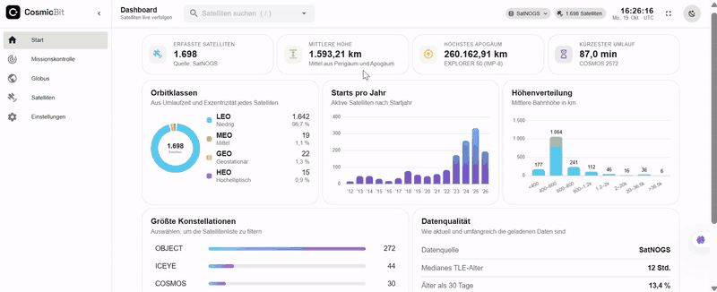

<div align="center">


# CosmicBit

### The live satellite catalog, in your browser.

Real-time tracking of ~10,000 satellites on an interactive 3D globe,<br/>
with SGP4 running in a Web Worker, one draw call for the whole sky, and no backend at all.

<br/>


[**Demo**](#-demo) · [**Features**](#-features) · [**Under the hood**](#-under-the-hood) · [**Structure**](#-project-structure) · [**Contact**](#-contact)

</div>

<br/>

> [!NOTE]
> This is a **showcase repository** with a demo video and notes on the architecture.
> The full source code is private, and **access is available on request**: see [Contact](#-contact).

<br/>

## 🎬 Demo

<p align="center"></p>

<p align="center"><sub>The GIF is compressed. A <b>full-quality video</b> (1916×780, 30 fps) is in <a href="media/demo.mp4"><code>media/demo.mp4</code></a>.</sub></p>

## ✨ Features

<table>
  <tr>
    <td width="50%" valign="top">
      <h4>🌍 Live 3D globe</h4>
      Thousands of satellites as one point cloud, coloured by orbit class (LEO, MEO, GEO, HEO), with hover tooltips, click-to-track and filters for orbit class and watchlist.
    </td>
    <td width="50%" valign="top">
      <h4>🛰️ Orbits with eclipses</h4>
      Previous, current and next orbit of the selected satellite, with the parts in Earth's shadow highlighted, plus the Sun, stars and the night side.
    </td>
  </tr>
  <tr>
    <td valign="top">
      <h4>🎛️ Mission control</h4>
      A watchlist of up to 12 satellites, a ground-track map with the day/night terminator, live telemetry and a <b>simulated battery chart</b> driven by real sunlight and eclipse timing.
    </td>
    <td valign="top">
      <h4>🔍 TLE decoder</h4>
      Every field of an element set decoded and explained: B*, RAAN, eccentricity, epoch and the mod-10 checksum check.
    </td>
  </tr>
  <tr>
    <td valign="top">
      <h4>📊 Analytics dashboard</h4>
      Orbit-class donut, launches per year, altitude histogram, the largest constellations and how fresh the data is.
    </td>
    <td valign="top">
      <h4>🗂️ Sortable catalog</h4>
      Search and sort the whole catalog by perigee, apogee, period, inclination, eccentricity and TLE age.
    </td>
  </tr>
  <tr>
    <td valign="top">
      <h4>🌐 Multilingual</h4>
      English, German, Spanish, French, Kurdish (Kurmanji) and more, with numbers formatted for each language. Light and dark themes.
    </td>
    <td valign="top">
      <h4>🛡️ Resilient data loading</h4>
      Validated input, a 2-hour cache, automatic fallback across data providers and rate-limit backoff.
    </td>
  </tr>
  <tr>
    <td valign="top">
      <h4>📚 How it works</h4>
      A built-in Learn page that explains the science behind the app: Kepler's laws, SGP4, coordinate frames, the Sun and Earth's shadow. It has a clickable TLE, a Kepler calculator that uses the app's own orbit code, and the real code excerpts.
    </td>
    <td valign="top">
      <h4>⚙️ Made to explore</h4>
      Quick search with <kbd>/</kbd>, shareable links (<code>/globe?sat=25544</code>), simulation speed up to 600×, base maps, day/night lighting, orbit styles, units and coordinate formats, all saved in the browser.
    </td>
  </tr>
</table>

## ⚙️ Under the hood

<div align="center">

| ~10,000 | 1 | 1 Hz | 0 | 164 |
| :---: | :---: | :---: | :---: | :---: |
| satellites propagated live | draw call for the whole catalog | position refresh, off the main thread | backend servers | unit tests |

</div>

### Engineering decisions

| Challenge | Solution |
| --- | --- |
| SGP4 for ~10k satellites drops frames on the main thread | A **Web Worker** gets the TLEs once, then only a timestamp each second, and returns a `Float64Array` that is **transferred, not copied** |
| One three.js object per satellite means thousands of draw calls | One `THREE.Points` cloud whose buffer is **rewritten in place**: a single draw call. globe.gl's data layers are used only for the Earth, because they rebuild geometry on every change |
| Clicking one point among thousands | **Screen-space picking**: project the points and take the nearest within 8 px, with a ray–sphere test to skip points behind the Earth |
| CesiumJS is heavy | Moved to **globe.gl** for a lighter, mostly MIT stack. Trade-off: a spherical Earth and no 2D views, which makes no visible difference at satellite scale |
| How often to refresh? | **1 Hz**: LEO satellites move ~7.5 km/s, a few pixels per second at globe zoom, so it looks smooth and keeps CPU use low |
| km, metres and two axis conventions | All ECF ↔ scene conversions live in **one module**; every propagation result is checked with `Number.isFinite`, because stale TLEs produce `NaN` |
| Data comes from third parties | Names are rendered as text, never HTML; TLE lines must belong to the same satellite; `localStorage` is parsed in `try/catch` and merged over defaults |
| CelesTrak blocks IPs that download too often | A 2-hour cache, one request per data group, and a **2-hour backoff after 403/429 that survives page reloads** |
| Trusting the math | Unit tests on real element sets for parsing, checksums, orbit classes, sun position, eclipses and the battery model. **They found three real bugs.** |

### Architecture in one paragraph

Views are thin: they load data and lay out components. Orbit math, TLE parsing, sun position and the battery model are plain JavaScript modules with unit tests. A single globe component owns every three.js object, worker and timer, and disposes all of them together with the WebGL context on unmount. Settings are one reactive object, validated and merged over defaults when loaded from `localStorage`.

## 🗂️ Project structure

About 7,500 lines of Vue and JavaScript (not counting tests and translations). Pages stay thin, and the logic lives in plain, unit-tested modules:

```text
src/
├── router/                     Routes; every page except the dashboard is lazy-loaded
├── views/                      Thin pages: dashboard, globe, catalog, satellite detail,
│                               mission control, learn, settings
├── components/
│   ├── globe/                  3D globe: three.js scene, point cloud, orbit lines, night side, stars
│   ├── home/                   Dashboard widgets: stat cards, donut, bar charts, constellations
│   ├── mission/                Watchlist, ground-track map, power panel, battery chart
│   ├── satellites/             Catalog table and pager
│   ├── satellite-detail/       Header, live position, orbital elements, raw TLE
│   ├── learn/                  Topic cards, diagrams, clickable TLE, Kepler calculator
│   ├── settings/               One component per settings tab
│   ├── layout/                 App header and logo
│   └── common/                 Shared building blocks used by several pages
├── composables/                Shared reactive state: catalog, settings, watchlist, live positions
├── services/                   Domain logic: TLE loading, orbit maths, sun, battery
├── utils/                      Formatting, coordinate conversion, simulation clock
├── workers/                    SGP4 for the whole catalog, off the main thread
├── i18n/                       Translations, one file per language
├── plugins/                    Chart.js registration
└── test/                       Real TLEs used by the tests
```

Tests sit next to the code they cover (`stats.js` → `stats.test.js`): every module in `utils/` and every service except `power.js`, which only combines the tested `sun.js` and `battery.js`. The composables, the translations and the TLE field map have tests too: 15 test files in total.

## ✅ Quality

- [x] **164 unit tests** in 15 files (Vitest + jsdom) for the services, utilities and composables
- [x] **CI on every push**: lint, tests and production build on GitHub Actions
- [x] **ESLint** with the Vue plugin, **Prettier** config
- [x] **No leaks**: three.js geometries, materials, textures, the worker, timers and the WebGL context are disposed on unmount
- [x] **Code-split routes**: globe.gl and three.js load only on pages that show a globe
- [x] **Privacy-minded**: fonts and imagery are bundled; the only third-party requests are satellite data and map tiles

## 🧰 Tech stack

| Area | Tools |
| --- | --- |
| Framework | Vue 3 (`<script setup>`), Vue Router, Vuetify 3 |
| 3D | globe.gl, three.js (custom point cloud, fat lines, shaders) |
| Orbital mechanics | satellite.js (SGP4), own sun-position and eclipse model |
| Charts | Chart.js via vue-chartjs |
| i18n | vue-i18n, multiple languages, a test that keeps every language's keys in sync |
| Tooling | Vite, Vitest, ESLint, Prettier, GitHub Actions |

## 🙏 Credits

Orbital data from [CelesTrak](https://celestrak.org), [SatNOGS DB](https://db.satnogs.org) (CC BY-SA 4.0) and the community [TLE API](https://tle.ivanstanojevic.me).
Globe imagery in the videos © Esri, Maxar, Earthstar Geographics and the GIS User Community; the mission map uses NASA Blue Marble.
Built on globe.gl, three.js, satellite.js, Vue, Vuetify and Chart.js.

## 📬 Contact

<div align="center">

**Salah Abdullah**

[](https://github.com/salah-abdullah)
<!-- Add more, e.g.:
[](https://www.linkedin.com/in/YOUR-PROFILE)
[](mailto:YOUR-EMAIL)
-->

Interested in the source code? Get in touch and I'll give you access to the private repository.

</div>
